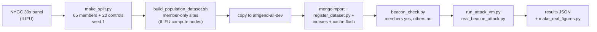
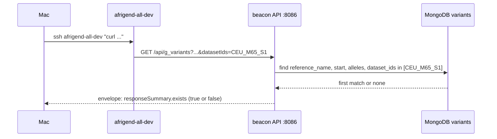
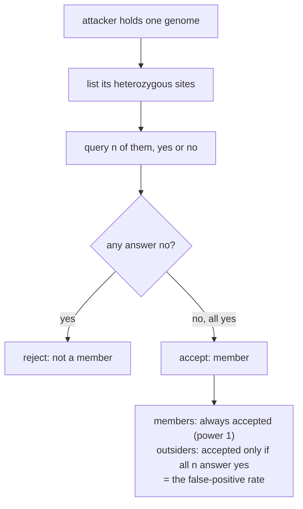
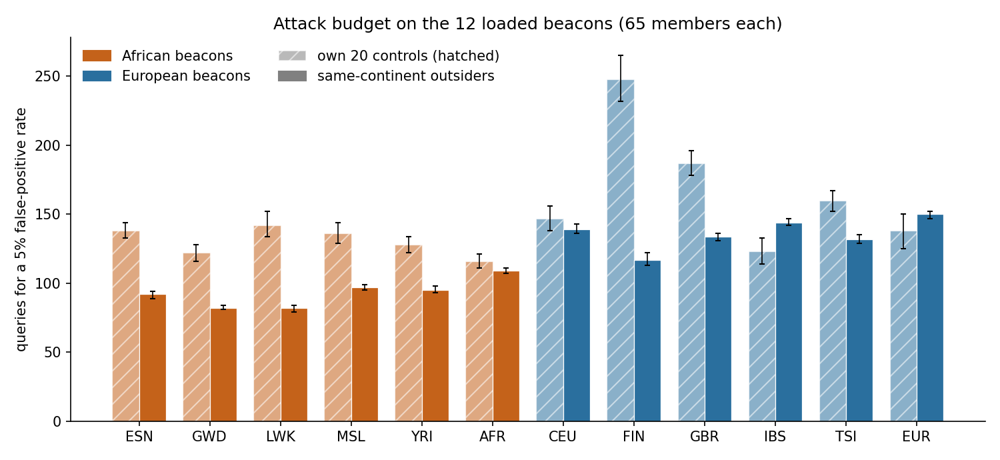
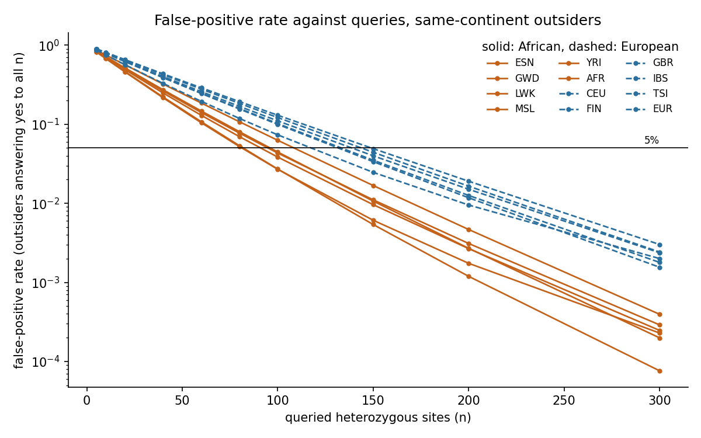

# Docs: what was done and how

The study measures how well a membership-inference attack on a Beacon works on
African and European cohorts. This folder explains the work on the twelve
population beacons loaded on `afrigend-all-dev`, how to query them, and what the
attack found. State as of 2026-10-28.

## What was done

1. Twelve beacons were built from the 1000 Genomes NYGC 30x GRCh38 panel
   (chromosomes 20 to 22): ten populations (ESN GWD LWK MSL YRI; CEU FIN GBR IBS
   TSI) and two pooled sets (AFR, EUR). Each holds 65 members, with 20 held-out
   controls that are not loaded (datasets `<POP>_M65_S1`).
2. They were loaded on the dev VM (9,859,803 variants in total) and all twelve pass
   the correctness check.
3. The attack was scored against each beacon's real contents: members are always
   detected, so the quantity that varies is the false-positive rate of outsiders.
4. A check of the loaded beacon found that it returns allele frequencies on request
   (`requestedGranularity=aggregated`) that reveal the exact carrier count at this
   cohort size. See [the beacon guide](the-loaded-beacon-and-its-queries.md),
   section 5.

## How: the pipeline

## How: one query

## How: the attack

## Results

Queries needed for a 5 per cent false-positive rate, per beacon:

False-positive rate against the number of queried sites (same-continent
outsiders):

The numbers behind the figures, the method and its limits are in
[`../analysis/power/README.md`](../analysis/power/README.md). The figures are
produced by `../analysis/power/make_real_figures.py` from the JSON files that
`run_attack_vm.py` writes.

## The docs

| Document | What it covers |
| --- | --- |
| [`the-loaded-beacon-and-its-queries.md`](the-loaded-beacon-and-its-queries.md) | What the beacon is and every query that explores it, with ready commands; the frequency finding; how it differs from the Beacon v2 specification |
| [`querying-and-attacking-the-loaded-beacons.md`](querying-and-attacking-the-loaded-beacons.md) | Reaching the VM, querying one dataset, the correctness check, running the attack on all twelve |
| [`rebuild-steps-for-taine.md`](rebuild-steps-for-taine.md) | Building, loading and verifying the twelve datasets, step by step |
| [`reload-population-beacons.md`](reload-population-beacons.md) | The runbook for reloading the population beacons |
| [`beacon-constraints.md`](beacon-constraints.md) | The live beacon's operational limits: rate limit, GRCh38 only, N is public |
| [`methods-lrt.md`](methods-lrt.md) | The likelihood-ratio test written out |
| [`background.md`](background.md) | The proposal's references, grouped by use |
| [`../analysis/power/README.md`](../analysis/power/README.md) | The attack method, results and limits |
| [`../data/README.md`](../data/README.md) | Cohort provenance, relatedness and sample overlap |
