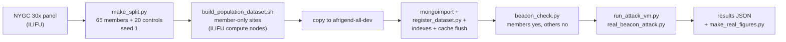
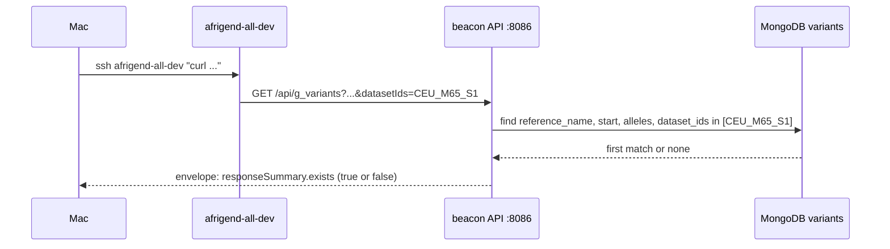
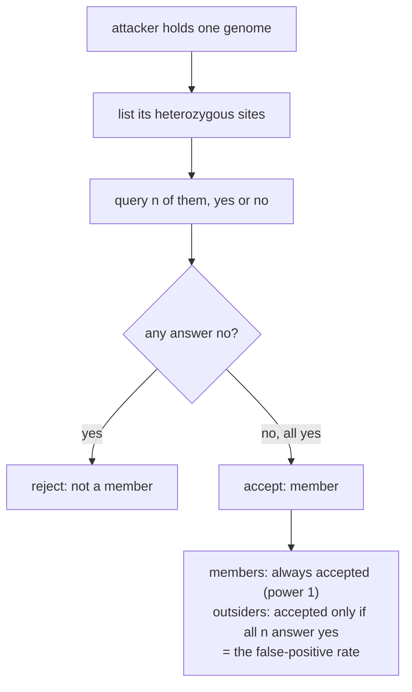
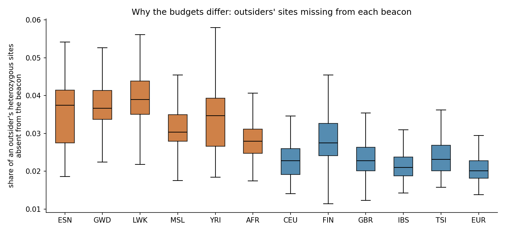
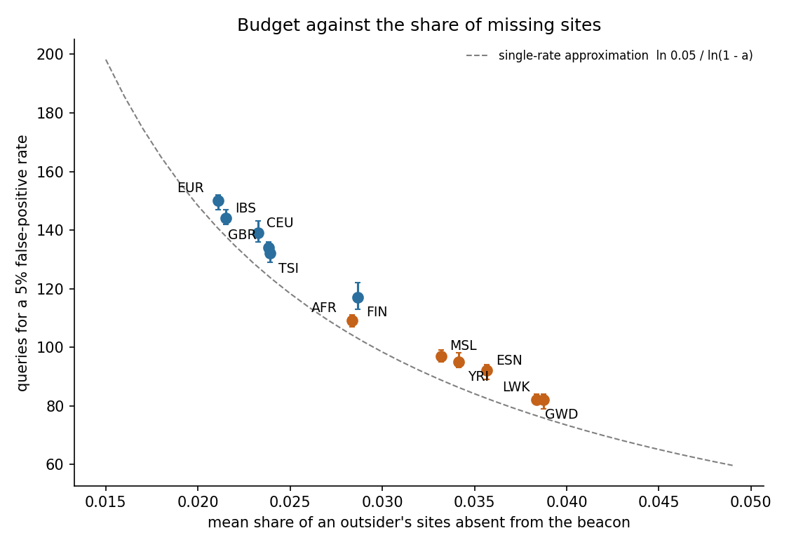
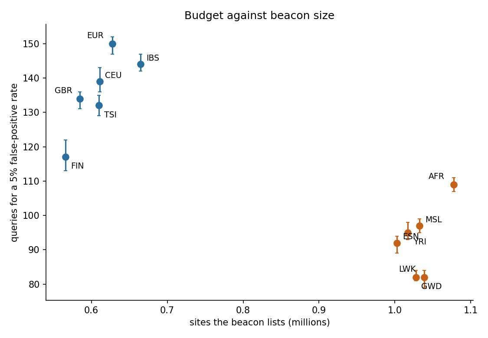
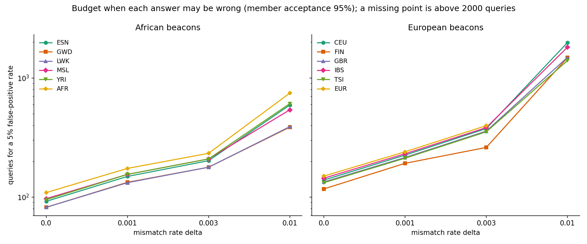
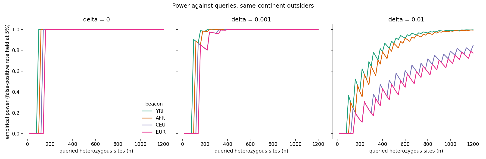

# Docs: what was done and how

The study measures how well a membership-inference attack on a Beacon works on
African and European cohorts. This folder explains the work on the twelve
population beacons loaded on `afrigend-all-dev`, how to query them, and what the
attack found. State as of 2026-10-28.

## What was done

1. Twelve beacons were built from the 1000 Genomes NYGC 30x GRCh38 panel
   (chromosomes 20 to 22): ten populations (ESN GWD LWK MSL YRI; CEU FIN GBR IBS
   TSI) and two pooled sets (AFR, EUR). Each holds 65 members, with 20 held-out
   controls that are not loaded (datasets `<POP>_M65_S1`).
2. They were loaded on the dev VM (9,859,803 variants in total) and all twelve pass
   the correctness check.
3. The attack was scored against each beacon's real contents: members are always
   detected, so the quantity that varies is the false-positive rate of outsiders.
4. A check of the loaded beacon found that it returns allele frequencies on request
   (`requestedGranularity=aggregated`) that reveal the exact carrier count at this
   cohort size. See [the beacon guide](the-loaded-beacon-and-its-queries.md),
   section 5.

## How: the pipeline

The build starts on the cluster, where each population's 65 members are cut out
of the panel and every site that none of them carries is dropped, so a beacon
lists only what its members carry. The datasets are then copied to the dev VM,
loaded into the beacon's database and registered, and checked: a member's allele
must answer yes and an allele no member carries must answer no. Only then is the
attack scored.

## How: one query

One question is an HTTP request to the beacon on the VM, restricted to a single
dataset with `datasetIds`. The beacon looks for a stored variant with that
position, alleles and dataset, and answers only yes or no
(`responseSummary.exists`).

## How: the attack

The attacker holds one person's genome and asks the beacon about that person's
heterozygous positions, one at a time. A real member carries every allele they
have, so a member never gets a "no". An outsider eventually meets a site the
beacon does not list. So the rule is: reject membership as soon as one answer is
no. Members are always accepted; the quantity that varies is how many queries it
takes before an outsider is rejected.

This is the likelihood-ratio test with the mismatch rate `delta` set to zero.
That is justified here because the beacon is built from the same VCFs the attacker
queries, so a member's genome and the beacon agree exactly. If the attacker's
genome has errors (`delta` above zero), the test counts "no" answers instead; see
"Sensitivity to a non-zero mismatch rate" below.

## Results

Queries needed for a 5 per cent false-positive rate, per beacon:

False-positive rate against the number of queried sites (same-continent
outsiders). One panel per continent, one colour and marker per beacon, the number
of queries at 5 per cent in brackets:

Why the budgets differ: the share of an outsider's heterozygous sites that the
beacon does not list. The more sites are missing, the sooner an outsider gets a
"no":

The dashed line is `ln 0.05 / ln(1 - a)`, which treats every outsider as having
the same share `a`; the points lie above it because outsiders differ in their
share. The next figure plots the same budgets against the number of sites each
beacon lists. Size and ancestry are not separated by this design (see the limits
in `analysis/power/README.md`):

### What the figures show

- **Fewer queries on the African beacons.** Against same-continent outsiders the
  five African population beacons need 82 to 97 queries for a 5 per cent
  false-positive rate (mean 89.6), the five European ones 117 to 144 (mean 133.2);
  the pooled sets need 109 (AFR) and 150 (EUR). Every African beacon needs fewer
  queries than every European one, and the curves for the African beacons fall
  faster (budget figure and curves figure).
- **The reason is missing sites.** An outsider's heterozygous sites are more often
  absent from an African beacon: the mean share is 0.028 to 0.039 across the
  African beacons and 0.021 to 0.029 across the European ones. A higher share
  means a "no" arrives sooner, which is the falling budget against share in the
  scatter figure.
- **Against the beacon's own 20 controls the picture is weaker.** The direction
  is the same (mean 133 for African, 173 for European) but the ranges overlap (for
  example IBS needs 123) and each beacon has only 20 such people (FIN's 248 is an
  outlier). The bars with a hatch in the budget figure are these.
- **Size and ancestry move together.** The African beacons list about 1.0 million
  sites and the European ones about 0.6 million, so the size figure cannot say
  which of the two drives the budget.

### What the figures do not show

- That ancestry causes the difference. Each beacon was drawn once, the same
  outsiders are used for several beacons, size differs by ancestry, and
  sub-population structure inside each continent is not separated out. The limits
  are listed in `../analysis/power/README.md`.
- Anything about queries sent to the live beacon: the scoring sends none. Only 400
  live queries were sent, to check that the scoring agrees with the beacon's real
  answers (it did, every time).
- Anything about a beacon that answers wrongly on purpose or that withholds sites.
  An attacker whose own genome has errors is covered in the next section.

## Sensitivity to a non-zero mismatch rate

The paper's test does not reject on a single "no". It allows each queried genotype
to be wrong with probability `delta` (sequencing or calling error) and tests the
number of "no" answers. `analysis/power/binomial_delta.py` does this from the
saved results, sending no queries:

- a member's number of nos is Binomial(n, `delta`); the rule calls "member" when
  the number of nos is at most `c`, the smallest `c` that accepts a member with
  probability 0.95;
- an outsider's number of nos in `n` distinct sites is hypergeometric, from the
  saved counts of heterozygous sites and how many the beacon lacks;
- with `delta = 0`, `c = 0` and the budgets are exactly those above (a unit test
  checks this).

Queries for a 5 per cent false-positive rate, same-continent outsiders (the
figure has all twelve beacons; the values are in `figures/binomial_budgets.json`):

Empirical power (the share of members accepted) against queries, with the
false-positive rate held at 5 per cent, which is the quantity the paper's power
curve plots. The false-positive-rate figure above asks the other question: how
often an outsider is wrongly accepted at a given `n`.

What it shows and does not show:

- **The two curves are two views of one test.** At each `n` pick the cutoff `c`
  that holds the false-positive rate at 5 per cent, then read the power. At
  `delta = 0` that is a step: power is 0 below the budget (no cutoff holds 5 per
  cent) and 1 from it. With `delta` above zero the power rises gradually.
- **A mismatch rate raises every budget.** From 0.001 about 60 per cent more
  queries; at 0.01 the European beacons need 1,400 to 2,000 queries or do not
  reach 5 per cent within 2,000, against 390 to 750 for the African ones.
- **The saw-tooth at `delta = 0.01` is real, not noise.** The cutoff `c` is a whole
  number, so power drops each time `c` has to stay put while `n` grows and jumps
  when `c` rises by one. A randomised test would smooth it.
- **It does not say what delta an attacker faces.** The range 0.001 to 0.01 and
  the 95 per cent member acceptance are choices made here, not measurements.
  `methods-lrt.md` uses `delta = 1e-6` for the simulation.

The numbers behind the figures, the method and its limits are in
[`../analysis/power/README.md`](../analysis/power/README.md). The figures are
produced by `../analysis/power/make_real_figures.py` from the JSON files that
`run_attack_vm.py` writes.

## The docs

| Document | What it covers |
| --- | --- |
| [`the-loaded-beacon-and-its-queries.md`](the-loaded-beacon-and-its-queries.md) | What the beacon is and every query that explores it, with ready commands; the frequency finding; how it differs from the Beacon v2 specification |
| [`querying-and-attacking-the-loaded-beacons.md`](querying-and-attacking-the-loaded-beacons.md) | Reaching the VM, querying one dataset, the correctness check, running the attack on all twelve |
| [`rebuild-steps-for-taine.md`](rebuild-steps-for-taine.md) | Building, loading and verifying the twelve datasets, step by step |
| [`reload-population-beacons.md`](reload-population-beacons.md) | The runbook for reloading the population beacons |
| [`beacon-constraints.md`](beacon-constraints.md) | The live beacon's operational limits: rate limit, GRCh38 only, N is public |
| [`methods-lrt.md`](methods-lrt.md) | The likelihood-ratio test written out |
| [`background.md`](background.md) | The proposal's references, grouped by use |
| [`../analysis/power/README.md`](../analysis/power/README.md) | The attack method, results and limits |
| [`../data/README.md`](../data/README.md) | Cohort provenance, relatedness and sample overlap |
